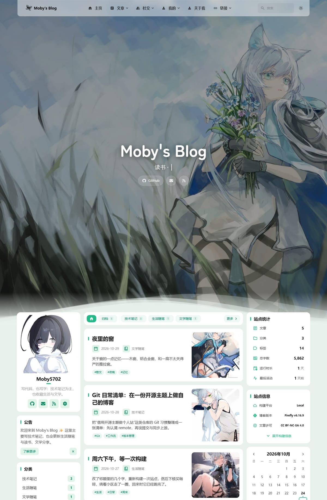

# Moby's Blog

> Code and words — mostly technical notes, occasionally life and literature.

A personal tech blog at <https://blog.265702.xyz>, built on the open-source [Firefly](https://github.com/CuteLeaf/Firefly) theme (Astro 7 + Svelte 5 + Tailwind CSS 4).

Every customization is marked with `[CUSTOM]` in the source; the full list is in [CUSTOMIZATION.md](./CUSTOMIZATION.md).



## Development

Requires Node.js >= 22.23 and pnpm 11 (the repo's `preinstall` enforces pnpm).

```bash
pnpm install
pnpm dev                         # http://localhost:4321
pnpm build                       # output to dist/
pnpm preview --host 127.0.0.1    # preview the build (defaults to IPv6 only)
```

## Writing a post

Posts live in `src/content/posts/`; **the file path determines the URL**: `my-post.md` → `/posts/my-post/`, `guide/index.md` → `/posts/guide/` (there is no `slug` field).

```yaml
---
title: Post title
published: 2026-10-30
description: One-line summary for lists and SEO
image: ./images/cover.webp
tags: [tag-one, tag-two]
category: 技术笔记
lang: "zh-CN"
draft: false
---
```

- Put images in `src/content/posts/images/` and reference them as `./images/xxx.webp`
- `draft: true` posts are visible in `pnpm dev` but hidden in production builds
- Use `series` + `seriesOrder` for a series, `password` for an encrypted post
- Or scaffold one: `pnpm new-post <filename>`

## Deployment: GitHub → Cloudflare Pages

The build output is plain static files.

- Build command: `pnpm build`
- Output directory: `dist`
- Environment variable: `NODE_VERSION=22.23.0` — **do not set `CF_WORKERS`**
- Custom domain: `blog.265702.xyz`

Before the first push, rename the mirror remote and add your own repository:

```bash
git remote rename origin upstream
git remote add origin https://github.com/mobydick5702-dev/<your-repo>.git
git push -u origin master
```

Full instructions (custom domain binding, syncing upstream Firefly) are in [BASELINE.md](./BASELINE.md).

## Documentation

| Document | What it covers |
| --- | --- |
| [BASELINE.md](./BASELINE.md) | Environment, build, deployment, daily workflow, upstream sync |
| [CUSTOMIZATION.md](./CUSTOMIZATION.md) | All customizations (old → new → revert), swapping avatar/wallpaper/site info |
| [VERIFICATION.md](./VERIFICATION.md) | Two rounds of independent verification |

## License & Credits

- Theme: [Firefly](https://github.com/CuteLeaf/Firefly), a fork of [Fuwari](https://github.com/saicaca/fuwari), MIT License
- Site content and customizations are MIT as well; original copyright notice in [LICENSE](./LICENSE) (© 2024 saicaca, © 2025 CuteLeaf)
