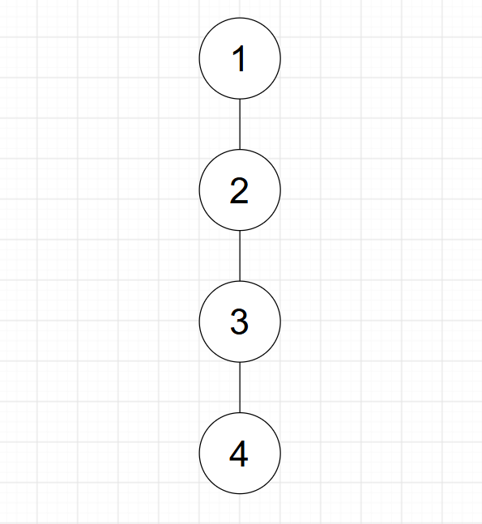
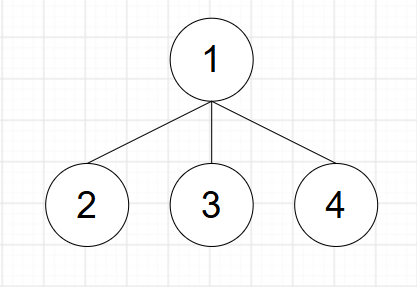

>并查集可以记录两个元素是否同属一类 / 动态合并同类，这是它在需要分类的题目中有很大的优势

并查集只有两种操作，查询和合并。

+ 查询：判断两个点u，v是否在同一个集合
+ 合并：把u，v两个点所在的集合合并为一个集合

简单来讲，就是你可以把一些元素归到一个类里，或者把两类元素合并成一类

那么接下来我们来看如何实现这一点：

在这里，我们选择使用数组来模拟并查集。数组i位置上存储i的父节点的编号。通过查询父结点判断两个元素是否在一个集合，或者进行合并。

代码如下：

1.初始化: 最开始没有合并时，每个节点的父结点都是它自己

```cpp
int father[N];
void init() {
    for(int i=1;i<=n;i++) father[i]=i;
}
```

2.查找:

```cpp
int find(int x) {
    if(father[x]==x) return x;
    return father[x]=find(father[x]);
}
```

在这里我们使用了`路径压缩`进行优化，具体会在下面进行讲解

3.合并: 把一方的父结点接到另一方的父结点下就好了

```cpp
void merge(int x,int y){
    father[find(x)]=find(y) 
}
```
接下来我们来讲find运用的优化

最开始，find的代码是
```cpp
int find(int x) {
    if(father[x]==x) return x;
    return find(father[x]);
}
```

直接`return find(father[x])`。十分简明易懂的递归。

但是，我们来看一种极端情况:



这种情况下，我们查询节点4时要把所有点都遍历一遍，时间复杂度是O(n)，显然这太高了。

为了解决这个问题，我们就要使用`路径压缩`。当每次遍历后，把子节点全都接到最上面的父结点上。即`return father[x]=find(father[x])`

如样例中，调用一遍find(4)后，就会把节点3,4都接在1上，变成这样:



那么，在压缩完之后时间复杂度提升了吗？提升了多少？

罗伯特·塔扬（Robert Tarjan）证明过，find 函数优化后时间复杂度变为 O(α(n))，而 merge 也变成了O(α(n))，其中 α 是一个函数，即使在 n 非常大的时候，α(n) 依然是一个小于 5 的常数。

#### 最后，讲讲并查集的应用

+ 1.连通性问题：

当询问图中某些点是否连通 / 图最终分成几个连通块 / 两点间是否有路径。

可以很轻易地看出可以维护一个并查集进行查询

+ 2.动态连通性

并查集可以十分轻松地处理动态的集合变化。这使得当图的边会在一定条件内增边/减边时，并查集可以处理一些链式前向星难以处理的图论问题

p.s.因为并查集只支持合并、不支持删除，所以天然适配"不断加边"。如果题目是"不断删边"，通常要离线 + 倒序处理，把删边变成加边，再上并查集。

+ 3.信息聚合

当不只要连通性，还要每个连通块的大小 / 元素和 / 最大值 / 元素个数等信息。时，也是并查集的优势区间

做法：把信息挂在根节点上（如本题的 sz[root]），merge 时把两个根的信息合并（sz[ra] += sz[rb]），find 后从根读取信息。

+ 4.关系问题

当给一堆"a 和 b 是同类"的关系，问是否矛盾，或问某两个是否同类。因为关系也能看做一种图中的连通，所以也可以用并查集求解

做法：每条关系 merge(a,b)；查询时 find(a)==find(b) 判同类。若关系带"敌人/不同类"，用种类并查集（开两倍空间，敌人连到对方的敌人上）。

+ 5.区间 / 序列上的*下一个可用位置*
一排位置，某些被占用，每次要找一个可用的位置填入，且要求尽量靠左/靠右。

做法：find(x) 表示"从 x 开始往右第一个可用位置"。占用 x 后令 father[x] = find(x+1)，相当于把 x 从可用集合中"删掉"，但用并查集实现了近似 O(1) 的"跳过已占用"。

典型例子：

座位安排 / 染色问题；

有些并查集优化 DP 的题（如"删数"类）。

+ 6.Kruskal 最小生成树

求最小生成树。

做法：按边权排序后依次取边，用 find 判断两端是否已连通——不连通才选这条边并 merge，否则跳过（避免成环）。并查集在这里负责"判环"。

典型例子：Kruskal 求 MST、最小瓶颈生成树、次小生成树的一部分。

这是并查集在图论算法内部最经典的嵌入方式。

